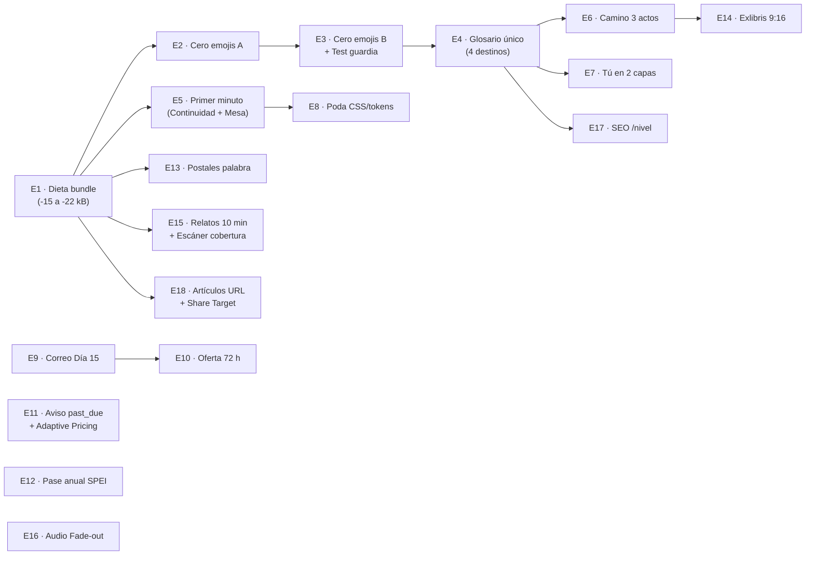

# Dirección Creativa y Elevación Integral de Lecta: plan de trabajo por fases

Propuesta del **2026-11-26**, diseñada específicamente para ejecutarse **una fase por commit con un modelo de IA ligero/económico** (p. ej. Sonnet o Flash), sin ambigüedades ni decisiones improvisadas en silencio.

Fuente: auditoría integral de identidad, UX, arquitectura de bundle, momentos compartibles, frecuencia de uso, distribución orgánica y cierre de monetización, contrastada con `PRODUCT.md`, `AGENTS.md` y el código real del repositorio (`HEAD` tras fase I de monetización).

---

## 1. Resumen ejecutivo

1. **Diagnóstico actual:** Lecta ya posee un motor técnico sobresaliente (posición exacta intra-párrafo, TTS neural offline en segundo plano con MediaSession, FSRS real, predicción léxica por Zipf, portal Kindle e-ink con código de 4 letras y una landing de nivel editorial en `marketing/landing/index.html`). Su techo hoy no es técnico: es **coherencia sensorial y sustracción**.
2. **Fricciones medidas el 2026-11-26:**
   - **Margen de arranque crítico:** `JS Inicial` está en **`202.01 / 205.00 kB` gzip** (quedan solo **`2.99 kB`**); `CSS Inicial` está en `24.70 / 55.00 kB` gzip (`scripts/check-bundle-budget.mjs`). Módulos no necesarios en el primer pintado de la estantería (`reading-sync` `6.54 kB`, `lexicon` `3.60 kB`, `epub` `3.49 kB`, `knowledge` `2.27 kB`, `word-form` `2.17 kB`, `stopwords` `1.91 kB`, `profile-models` `1.33 kB`) se arrastran hoy en el grafo estático inicial.
   - **Emojis de sistema:** aunque `marketing/landing/index.html` tiene cero emojis y `src/client/components/Icon.tsx` ya define más de 60 iconos vectoriales editoriales, 18+ componentes TSX usan emojis nativos (`GamePanel.tsx`: 19, `Journey.tsx`: 18, `CompanionPanel.tsx`: 15, `BookGlossaryModal.tsx`: 14, `PracticeCompanionHeader.tsx`: 12, `SectionPreview.tsx`: 7, `CompanionStage.tsx`: 7, `SentenceBuilderGame.tsx`: 5, `ReadingActivity.tsx`: 3, `ReaderRecapBubble.tsx`: 3, `ReaderNotices.tsx`: 2, `WordScrambleGame.tsx`: 2, `QuoteCardModal.tsx`: 2, `GrammarGame.tsx`: 2, `PracticeCard.tsx`: 1, `TtsConsentDialog.tsx`: 1, `ResumeSessionOverlay.tsx`: 1, `ProgressInk.tsx`: 1).
   - **Glosario dividido:** `AppNav.tsx` nombra `Biblioteca · Cuaderno · Camino · Perfil`, mientras las cabeceras internas muestran `Tu recorrido` (`Journey.tsx`), `Tú` (`Account.tsx`), `Cuaderno` (`Vocabulary.tsx`) y la landing habla de `Herbario`.
   - **Primer minuto con ruido:** `Shelf.tsx` apila `TrialStatusLine`, `shelf-welcome-hero`, `CoatChoice`, `shelf-onboarding-card` (checklist de 3 pasos con jerga como *«Afinar mi nivel en 45 seg»*, *«Estrategia»* y *«notas léxicas»*) y la caja de arrastre EPUB. Y tras probar un clásico con `/?probar=<id>`, crear cuenta deja al usuario en la estantería en lugar de devolverlo al libro.
3. **Capacidades ya existentes que se aprovechan (no reconstruir):**
   - `QuoteCardFormat` en `src/client/lib/quote-card.ts` ya soporta `"portrait" | "story" | "square"` y paletas editoriales.
   - `src/client/lib/ttsController.ts` y `src/client/components/SmartReaderDock.tsx` ya implementan `sleepTimerEndsAt`, `sleepAtChapterEnd` y `dock-audio-capture-btn`.
   - `CatalogBook` en `src/client/lib/catalog.ts` ya incluye `wordCount` para filtrar relatos cortos sin descargar EPUBs.
4. **Orden del plan (18 fases `E1`–`E18`):**
   - **Bloque 0 (`E1`):** Dieta del grafo estático inicial para recuperar ~15–22 kB de margen antes de tocar UX.
   - **Bloque 1 (`E2`–`E5`):** Cero emojis en UI, glosario único de 4 destinos y primer minuto sin checklist ni cortes desde `/?probar=`.
   - **Bloque 2 (`E6`–`E8`):** Sustracción en `Journey.tsx` (3 actos), `Account.tsx` (2 capas) y limpieza de CSS/tokens.
   - **Bloque 3 (`E9`–`E12`):** Cierre completo de monetización y retención de suscriptores (correo Día 15, oferta 72 h, aviso `past_due` + Adaptive Pricing, pase anual SPEI/OXXO).
   - **Bloque 4 (`E13`–`E16`):** Cuatro momentos de firma (Postales con palabra destacada, Ceremonia de Exlibris 9:16, Relatos de 10 min + escalera inglés + escáner de cobertura, Audio nocturno con fade-out `GainNode`).
   - **Bloque 5 (`E17`–`E18`):** Distribución orgánica y hábito diario (herramienta SEO pública `/nivel` y lectura de artículos largos por URL + PWA `share_target`).

---

## 2. Reglas inquebrantables para el modelo ejecutor

Toda ejecución de una fase `E<n>` debe cumplir **sin excepción**:

1. **Zero-Friction manda** (`AGENTS.md`, `PRODUCT.md`, `.agents/rules/lecta-zero-friction.md`):
   - Tocar un libro en `Shelf.tsx` abre directamente el lector (`openBook`); nada a pantalla completa se interpone.
   - Ninguna pantalla ni tarjeta muestra jerga psicométrica o técnica al lector (`Theta`, `FSRS`, `Estrategia`, `notas léxicas`, `calibrar`) salvo en letra chica informativa o diagnóstico.
   - En `Reader.tsx` existe un único dock inferior (`SmartReaderDock.tsx`).
   - Todo título visible de libro pasa por `bookDisplayName` / `displayTitle` (`src/client/lib/cover.ts`, `src/shared/epub-meta.ts`), nunca por hashes o nombres crudos de archivo.
2. **Una fase = un commit atómico.** Prohibido mezclar cambios de otra fase, renombrar símbolos fuera de alcance o refactorizar archivos no listados.
3. **No decidir producto en silencio:** si una fase tiene la marca **«Bloqueada por decisión de Luis (§6)»**, el modelo **no la ejecuta ni inventa copy/precios** hasta que Luis apruebe la fila correspondiente en §6.
4. **React Compiler y Lint estricto:** `pnpm lint` corre `eslint . --max-warnings 0`. Prohibido mutar `.current` de un `ref` en el cuerpo del render y prohibido dejar imports, props o variables huérfanas.
5. **Presupuesto de bundle:** ejecutar `pnpm check:size` al cierre de cada fase. A partir de `E1`, `JS Inicial` debe mantenerse **≤ `195.00 kB` gzip** (idealmente ≤ `185 kB`) y `CSS Inicial` **≤ `55.00 kB` gzip**. Toda nueva vista o generador Canvas debe cargarse con `React.lazy` o `import()` dinámico.
6. **Regla especial de `Reader.tsx`:** nunca correr `prettier --write` sobre `src/client/components/Reader.tsx`. Si alguna edición mueve de línea `applyPreviewKnownSignal(currentLang, beta)`, actualizar `docs/auditoria/claims.json` en el mismo commit.
7. **Base de datos y producción:** cero migraciones nuevas en esta hoja de ruta salvo autorización expresa; aprovechar `lecta_plan_events` (`035`) y `lecta_ai_quota` (`014`). Nunca correr `db:migrate` contra producción ni desplegar sin permiso.
8. **Puerta obligatoria de cierre:** cada fase añade pruebas Vitest que fallen sin el cambio, pasan tras implementarlo, y cierra con **`pnpm gate` en verde** (`typecheck` + `lint` + `test-trace` + `build` + `check:size`).

---

## 3. Fases de trabajo (`E1` a `E18`)

> **Formato para el ejecutor:** lee únicamente la fase asignada, aplica los cambios en los archivos exactos, respeta **«Qué NO tocar»**, escribe las pruebas pedidas y ejecuta `pnpm gate`.

---

### Bloque 0: Dieta de arranque (desbloquea margen de bundle)

#### E1. Dieta del grafo estático inicial (`≤ 185 kB` gzip)
- **Objetivo:** recuperar entre `15` y `22 kB` gzip en el grafo estático inicial para trabajar con holgura todo el plan.
- **Archivos exactos:**
  - `src/client/App.tsx`
  - `src/client/components/Shelf.tsx`
  - `src/client/lib/reading-sync.ts`, `src/client/lib/epub.ts`, `src/client/lib/lexicon.ts`, `src/client/lib/knowledge.ts`, `src/shared/word-form.ts`, `src/shared/stopwords.ts` (solo si hace falta extraer tipos a `import type` o dividir entradas pesadas).
  - Prueba nueva o ampliación en `scripts/check-bundle-budget.mjs` / `src/client/App.test.ts` (asegurar que ningún import estático reintroduzca estos chunks en el preload).
- **Cambios paso a paso:**
  1. Inspeccionar en `dist/client` qué imports estáticos en `App.tsx` y `Shelf.tsx` arrastran `reading-sync` (`6.54 kB`), `lexicon` (`3.60 kB`), `epub` (`3.49 kB`), `knowledge` (`2.27 kB`), `word-form` (`2.17 kB`) y `stopwords` (`1.91 kB`).
  2. Convertir llamadas que solo se ejecutan tras abrir sesión, importar EPUB, calibrar o sincronizar (p. ej. `syncSavedWords`, `syncAnnotations`, `syncActivity`, `syncPositions`, `readBookMeta`, `estimateStoredProfile`, `lookupLocalLexicon`, helpers de `epub.ts`) a `import(...)` dinámico en el punto de uso, dejando en cabecera solo `import type`.
  3. Verificar que el primer render de `App` / `Shelf` no pierda funcionalidad ni dispare waterfalls visibles en interacción (precargar en `requestIdleCallback` si procede después del primer pintado).
- **Qué NO tocar:** no cambiar lógica de negocio de sync, ni `idb.ts`, ni `Reader.tsx`, ni subir ni bajar `MAX_JS_GZIP_KB` en `check-bundle-budget.mjs` (el tope sigue siendo `205 kB`).
- **Verificación:**
  - `pnpm build && pnpm check:size` muestra `JS Inicial ≤ 188.00 kB` gzip (meta objetivo `≤ 185 kB`, ahorro mínimo `14 kB` respecto a `202.01 kB`).
  - `pnpm gate` en verde (incluyendo `App.test.ts` y `Shelf.test.ts`).
- **Riesgo:** medio (imports asíncronos deben conservar manejo de errores en sync). **Migración:** no. **‖** ninguna (va primero). **Dep.:** ninguna.

---

### Bloque 1: Coherencia de marca, dirección de arte y primer minuto

#### E2. Cero emojis de sistema — Parte A (navegación, lector, audio y recorrido)
- **Objetivo:** sustituir todos los emojis nativos por iconos vectoriales de `Icon.tsx` o texto limpio en los flujos principales de lectura y recorrido.
- **Archivos exactos:**
  - `src/client/components/Icon.tsx` (añadir solo los iconos faltantes con trazo `strokeWidth="1.5"`: `"mail"`, `"heart"`, `"sun"` o `"lock"` si ya no existe — `lock`, `gift`, `bulb`, `paw`, `target`, `shirt`, `scroll`, `book`, `sparkles`, `search`, `headphones`, `trash`, `close`, `check`, `star`, `droplet`, `shield`, `wave`, `edit`, `shuffle`, `zap`, `chart` **ya existen** en `Icon.tsx`).
  - `src/client/components/Journey.tsx` (18 ocurrencias: `👕💌🎯📜🐾🔒✕🎁💡🌊🔍✨`)
  - `src/client/components/ResumeSessionOverlay.tsx` (`📖`)
  - `src/client/components/ReadingActivity.tsx` (`🛡🐾🌊`)
  - `src/client/components/ProgressInk.tsx` (`💧`)
  - `src/client/components/TtsConsentDialog.tsx` (`🗑`)
  - `src/client/components/reader/ReaderNotices.tsx` (`✕🎧`)
  - `src/client/components/reader/ReaderFloatingBars.tsx` (`★`)
  - `src/client/components/DeepReadingSummaryModal.tsx` (`✕`)
  - `src/client/components/ThemeMenu.tsx` (`✕`)
  - `src/client/components/OfflineDictionaryControl.tsx` (`✓`)
  - `src/client/components/Shelf.tsx`, `ScreenShelf.tsx`, `ScreenPrepareSheet.tsx` (`✓`)
- **Cambios paso a paso:**
  1. Revisar `IconName` en `src/client/components/Icon.tsx` y añadir únicamente los nombres estrictamente necesarios (`"mail"`, `"heart"`, `"award"` si hiciera falta).
  2. En los archivos listados, reemplazar cada emoji visual por `<Icon name="..." size={16} />` (con `aria-hidden="true"` heredado por `Icon`) y reemplazar los símbolos `✕` / `✓` en botones de cierre o confirmación por `<Icon name="close" size={16} />` o `<Icon name="check" size={15} />` manteniendo los `aria-label` intactos.
  3. No cambiar textos que las pruebas existentes verifiquen (`expect(text).toContain(...)`) salvo quitar el emoji decorativo.
- **Qué NO tocar:** no tocar `GamePanel.tsx`, `CompanionPanel.tsx` ni los juegos (van en `E3`). No tocar lógica de negocio ni `Reader.tsx`.
- **Verificación:**
  - Ejecutar el chequeo de emojis sobre los archivos de esta fase (0 coincidencias).
  - Actualizar o añadir pruebas en `Journey.test.ts` y `ResumeSessionOverlay.test.ts` verificando que renderizan sin emojis Unicode en su DOM.
  - `pnpm gate`.
- **Riesgo:** bajo. **Migración:** no. **‖** E9, E11. **Dep.:** E1.

#### E3. Cero emojis de sistema — Parte B (compañero, juegos y glosario + prueba guardia)
- **Objetivo:** erradicar los emojis restantes en los paneles secundarios y blindar el repositorio contra futuras regresiones.
- **Archivos exactos:**
  - `src/client/components/GamePanel.tsx` (19: `🐾✕✍📜📖😻😺🤔🌱✨🚫`)
  - `src/client/components/CompanionPanel.tsx` (15: `🐱✕✨👥🌱🎀🔥✎🎁✓`)
  - `src/client/components/BookGlossaryModal.tsx` (14: `📖📑✦🔖🔍✕⚡🔤📊✓`)
  - `src/client/components/PracticeCompanionHeader.tsx` (12)
  - `src/client/components/SectionPreview.tsx` (7)
  - `src/client/components/CompanionStage.tsx` (7)
  - `src/client/components/SentenceBuilderGame.tsx` (5)
  - `src/client/components/ReaderRecapBubble.tsx` (3)
  - `src/client/components/WordPanel.tsx` (`★✓✕`)
  - `src/client/components/WordScrambleGame.tsx`, `QuoteCardModal.tsx`, `GrammarGame.tsx`, `TtsNowPlaying.tsx`, `notebook/PracticeCard.tsx`
  - **Nuevo test guardia:** `src/client/components/no-system-emoji.test.ts`
- **Cambios paso a paso:**
  1. Sustituir cada emoji por el `<Icon name="..." />` correspondiente (p. ej. `cat`, `paw`, `sparkles`, `edit`, `scroll`, `book`, `search`, `zap`, `chart`, `gift`, `sprout`, `ban`, `close`, `check`, `star`, `bulb`, `shuffle`, `speaker`). En las reacciones del gato en `GamePanel.tsx` (`😻`/`😺`/`🤔`), usar etiqueta textual serena (`"Ronroneo"`, `"Curioso"`, `"Pensativo"`) junto a `<Icon name="cat" />`.
  2. Crear `src/client/components/no-system-emoji.test.ts` que recorra `src/client/components/**/*.tsx` (excluyendo `*.test.*`) y falle si encuentra cualquier carácter en los rangos de emoji de sistema `[\u{1F300}-\u{1FAFF}\u{2600}-\u{26FF}\u{2700}-\u{27BF}]` (permitiendo únicamente comillas tipográficas `«»`, puntos `·`, flechas `→←›` y asteriscos editoriales en prosa).
  3. Verificar si `WordPanel.test.ts`, `GamePanel.test.ts` o `BookGlossaryModal.test.ts` buscaban algún carácter literal `★`/`✓`/`✕` y actualizar esas aserciones si el icono pasó a SVG (`aria-label` o `svg.icon--star`).
- **Qué NO tocar:** no tocar archivos de servidor ni CSS de temas; no borrar texto de pruebas sin actualizar el test correspondiente.
- **Verificación:**
  - `pnpm vitest run src/client/components/no-system-emoji.test.ts` falla antes de limpiar los 14 archivos y pasa después.
  - `pnpm gate`.
- **Riesgo:** bajo-medio (revisar tests existentes que comprueben texto exacto de botones). **Migración:** no. **‖** E5, E9. **Dep.:** E2.

#### E4. Glosario único de 4 destinos
- **Objetivo:** que cada vista principal tenga exactamente **un nombre** coherente en barra de navegación, `<h1>`, título de diálogo, `manifest.webmanifest` y landing.
- **Bloqueada por decisión de Luis (§6, #1):** nombre elegido para los 4 destinos (recomendado: **`Biblioteca · Herbario · Camino · Tú`**).
- **Archivos exactos:**
  - `src/client/components/AppNav.tsx` (etiquetas en líneas 86, 107, 128, 139)
  - `src/client/components/Vocabulary.tsx` (`aria-label` y `<h1 className="notebook-title">`, líneas 596 y 642–644)
  - `src/client/components/Journey.tsx` (`eyebrow`, `<h1>` y `aria-label`, líneas 524–536)
  - `src/client/components/Account.tsx` (`aria-label="Tú"`, `<h1>Tú</h1>`, línea 867–870)
  - `src/client/components/Shelf.tsx`, `Reader.tsx` / `reader/ChapterEndCard.tsx`, `App.tsx` (mensajes que digan «Cuaderno» o «Perfil»)
  - `public/manifest.webmanifest` (`name` y `description`)
  - `marketing/landing/index.html` (menciones de navegación / destinos si difieren)
  - Pruebas que aserten etiquetas de navegación (`src/client/App.test.ts`, `src/client/components/AppNav.test.ts` si existe, `ChapterEndCard.test.ts`, `Vocabulary.test.ts`).
- **Cambios paso a paso:**
  1. Fijar las 4 etiquetas aprobadas por Luis en `AppNav.tsx` (por defecto recomendado: `Biblioteca`, `Herbario`, `Camino`, `Tú`).
  2. Alinear el `<h1>` y `aria-label` de cada vista al mismo nombre (`Journey.tsx`: `<h1>Camino</h1>` con `eyebrow` `Lectura y palabras`; `Account.tsx`: `<h1>Tú</h1>`; `Vocabulary.tsx`: `<h1>Herbario</h1>` cuando no está en modo `Aprender`/`Repaso`).
  3. Unificar las referencias cruzadas en botones/mensajes visibles (`Ver Herbario`, `Guardada en Herbario`) y actualizar `public/manifest.webmanifest`.
- **Qué NO tocar:** no renombrar símbolos internos de código ni rutas/tablas/claves de IndexedDB (`Vocabulary.tsx`, `lecta_user_words`, `nav="vocabulary"` se mantienen internamente para no romper persistencia ni tests de rutas).
- **Verificación:**
  - Prueba en `App.test.ts` (o `AppNav.test.ts`) comprobando que cada botón de `AppNav` coincide con el título principal de la vista que abre.
  - `pnpm gate`.
- **Riesgo:** medio (requiere actualizar aserciones literales en tests existentes). **Migración:** no. **‖** E6, E7. **Dep.:** E3 y Decisión #1 de §6.

#### E5. Primer minuto impecable: continuidad desde `/?probar=` y mesa despejada en `Shelf.tsx`
- **Objetivo:** eliminar la saturación de tarjetas de onboarding para usuarios nuevos y devolver automáticamente al libro probado cuando alguien crea su cuenta desde `/?probar=<id>`.
- **Archivos exactos:**
  - `src/client/App.tsx` (flujo `trial` y `openTrialBook`, líneas 1552–1586 y 2248–2260)
  - `src/client/components/Shelf.tsx` (bloque `isFirstTimeReader`, `showOnboarding` y lenguaje escolar, líneas 855–1055)
  - `src/client/components/Shelf.test.ts` y `src/client/App.test.ts`
- **Cambios paso a paso:**
  1. **Continuidad `/?probar=` → cuenta creada:** en `App.tsx`, cuando `trial` pasa a `"ended"` (usuario anónimo cerró el clásico de prueba para registrarse), guardar en `sessionStorage` la clave `lecta:resume-trial-book` con el `id` del libro probado (`trialBook.id`) y borrarla al usarla o descartarla. Cuando `sessionUserId` pasa a estar autenticado y existe `lecta:resume-trial-book`, buscar el libro en el catálogo (o en `library` ya migrada por `migrateAnonymousToUser`) y abrirlo directamente con `openStoredBook` / `getCatalogBook` (respetando la regla de apertura inmediata y sin mostrar `Shelf` intermedia).
  2. **Demoler el checklist escolar en `Shelf.tsx`:** retirar el bloque `shelf-onboarding-card` (los 3 pasos «Afinar mi nivel en 45 seg», «Abrir mi primer capítulo con una Estrategia», «Tocar una palabra nueva y acariciar al gato»). Conservar intacto `CoatChoice` si `needsCoatChoice(userPlan)` es true.
  3. **Unificar `isFirstTimeReader` en una única mesa editorial:** mostrar en una sola tarjeta limpia: saludo sereno del gato elegido + *«¿Con qué quieres empezar hoy?»* + 3 botones de acceso directo en 1 toque (p. ej. 1 relato corto en inglés, 1 novela en inglés y 1 clásico en español de `getCatalogBook`) + botón secundario *«Traer mi archivo EPUB»*. Eliminar cualquier mención a «Estrategia», «notas léxicas» o «45 seg».
- **Qué NO tocar:** no tocar la calibración desde `Tú` ni el aviso discreto de calibración al final del primer capítulo; no romper la tabla de decisión de `Welcome.tsx` en `App.test.ts`.
- **Verificación:**
  - Prueba en `App.test.ts`: al volver con sesión tras `/?probar=alice-wonderland`, se dispara la reapertura automática del libro y se limpia `lecta:resume-trial-book`.
  - Prueba en `Shelf.test.ts`: usuario nuevo ve la mesa limpia sin `shelf-onboarding-card` ni el texto `"Estrategia"` / `"45 seg"`.
  - `pnpm gate`.
- **Riesgo:** medio (revisar `ShelfPreflight.test.ts` y `Shelf.test.ts` por si esperaban `.shelf-onboarding-card`). **Migración:** no. **‖** E9, E11. **Dep.:** E1, E3.

---

### Bloque 2: Sustracción y claridad en vistas clave

#### E6. `Camino` (`Journey.tsx`) en 3 actos editoriales
- **Objetivo:** reducir la densidad vertical de `Journey.tsx` (1 549 líneas) en **3 actos claros**, dando aire al contenido de valor real (`CoachCard`, `StudyPlanCard`, `FluencyForecastCard`, Exlibris) y plegando lo secundario.
- **Archivos exactos:**
  - `src/client/components/Journey.tsx`
  - `src/client/components/Journey.test.ts`
  - `src/client/styles/game.css` (solo si requiere un ajuste menor de espaciado de actos)
- **Cambios paso a paso:**
  1. Reorganizar `Journey.tsx` en tres secciones principales con encabezados claros (`<h2>`):
     - **Acto 1 — Hoy:** Santuario compacto del gato + resumen `Hoy` (repasos vencidos, palabras dominadas, días seguidos) + `CoachCard` + `StudyPlanCard` (o la `PlanNote` agrupada en `free`).
     - **Acto 2 — Tu evolución:** `Horizonte de palabras` (con `FluencyForecastCard` por idioma) + `Vocabulario por etapas` + `JourneyInsights`.
     - **Acto 3 — Tu colección:** `Libros concluidos (Exlibris)` + `Sellos obtenidos`.
  2. Envolver `El Sendero de Tinta` (mapa SVG) y `Rango Literario` dentro de `<JourneyFold title="Sendero de tinta y rango" ...>` plegado por defecto (o accesible desde el subtítulo del gato), y mantener `Récords personales` plegado como ya está.
  3. Asegurar que todos los tests existentes en `Journey.test.ts` sigan encontrando los elementos esperados (si un test busca `.ink-node-btn` o `"Rango Literario"`, confirmar que `JourneyFold` renderiza su contenido o abrirlo en el test correspondiente).
- **Qué NO tocar:** no tocar la lógica de cálculo de `src/client/lib/journey.ts`, `CoachCard.tsx`, `StudyPlanCard.tsx` ni `FluencyForecastCard.tsx`.
- **Verificación:**
  - Prueba de orden DOM en `Journey.test.ts`: Acto 1 (`Hoy`, `Coach`/`StudyPlan`) aparece antes que Acto 2 (`Horizonte de palabras`), y Acto 2 antes que Acto 3 (`Libros concluidos`).
  - `pnpm gate`.
- **Riesgo:** bajo-medio (verificar `Journey.test.ts` completo). **Migración:** no. **‖** E7, E8. **Dep.:** E2, E4.

#### E7. `Tú` (`Account.tsx`) en 2 capas (protagonismo + cajón plegable)
- **Objetivo:** elevar el **Carné de Lector** y **Tu Kindle** como las dos piezas con personalidad arriba de `Tú`, y recoger las opciones administrativas detrás de bloques `<details className="account-fold">` limpios.
- **Archivos exactos:**
  - `src/client/components/Account.tsx`
  - `src/client/components/Account.test.ts`
  - `src/client/styles/app.css` (estilos sobrios para `.account-fold` usando variables de `tokens.css`)
- **Cambios paso a paso:**
  1. Mantener en primer plano arriba (sin plegar): enlace a `Camino` (`account-journey-row`), **`ReaderCard` (Carné de Lector)** y el bloque **Tu Kindle** (`kindle-panel`).
  2. Agrupar debajo en `<details className="account-fold">` (cerrados por defecto, con `<summary>` claro en `--font-ui` y mínimo 44 px de alto):
     - **Lectura y apariencia:** tema, preferencias de IA, historial local, compañero y nivel/calibración.
     - **Correos y avisos:** resumen semanal, correo de regreso, notificaciones.
     - **Cuenta, respaldos y datos:** sesión (`email`, cambiar contraseña, cerrar sesión), exportar/restaurar respaldo, diagnóstico, reiniciar datos y eliminar cuenta.
  3. Verificar que cuando llega `resetToken` o `error` de contraseña, el `<details>` correspondiente se abre automáticamente (`open={showChange || Boolean(error)}`) para no ocultar errores al usuario.
- **Qué NO tocar:** no tocar la lógica de auth, respaldos ni `ReaderCard.tsx`. Mantener los `aria-label` y `data-testid` que usa `Account.test.ts`.
- **Verificación:**
  - `pnpm vitest run src/client/components/Account.test.ts` + prueba nueva que verifique las 2 capas y apertura automática ante error de contraseña.
  - `pnpm gate`.
- **Riesgo:** medio (`Account.test.ts` tiene muchas pruebas de interacción; comprobar qué secciones esperan visibles sin clic previo). **Migración:** no. **‖** E6, E8. **Dep.:** E4.

#### E8. Higiene de `tokens.css` y poda de CSS muerto
- **Objetivo:** reducir redundancia en `src/client/styles/tokens.css` y bajar `CSS Inicial` eliminando selectores huérfanos heredados de rediseños pasados (`shelf-onboarding-card` retirado en E5, estilos no referenciados en TSX).
- **Archivos exactos:**
  - `src/client/styles/tokens.css`
  - `src/client/styles/game.css`, `src/client/styles/components.css`, `src/client/styles/shelf.css`
  - `src/client/styles/tokens.test.ts`
- **Cambios paso a paso:**
  1. Auditar con script en Node qué clases definidas en `shelf.css`, `components.css` y `game.css` ya no existen en ningún `.tsx` ni `.ts` (p. ej. `.shelf-onboarding-card`, `.onboarding-steps`, etc. tras `E5`) y eliminarlas con cuidado (excluir clases dinámicas armadas por prefijo como `cat--coat-*`, `theme-*`, `ink-node-*`).
  2. En `tokens.css`, documentar y consolidar alias redundantes apuntando todos al token canónico sin romper `tokens.test.ts` ni los temas `papel`, `blanco`, `noche` y `oled`.
- **Qué NO tocar:** prohibido introducir hexadecimales fuera de `tokens.css` (regla de `PRODUCT.md` verificada por `tokens.test.ts`). No tocar `reader.css` (afecta posición y paginación del lector).
- **Verificación:**
  - `pnpm vitest run src/client/styles/tokens.test.ts`.
  - `pnpm gate` con `CSS Inicial` menor o igual al previo (`≤ 24.70 kB` gzip).
- **Riesgo:** medio (no borrar clases generadas dinámicamente por template literal). **Migración:** no. **‖** E6, E7. **Dep.:** E5.

---

### Bloque 3: Cierre de monetización y retención de suscriptores

#### E9. Correo único de fin de prueba en Día 15 (`trial-end-email`)
- **Objetivo:** rescatar al ~70 % de usuarios activos cuya prueba inversa venció en las últimas 24–48 h y no abrieron la app ese día, enviando **un único correo honesto** con sus cifras reales de uso.
- **Bloqueada por decisión de Luis (§6, #2):** aprobar envío automático por Resend y asunto/texto.
- **Archivos exactos:**
  - Nuevo `src/worker/trial-end-email.ts` y `src/worker/trial-end-email.test.ts`
  - `src/worker/index.ts` (llamar en `scheduled`, en serie antes o después de `runReengage`, respetando la pausa de 500–600 ms por Resend)
  - `src/shared/plan.ts` (añadir `"app:trial-end-email"` o validarlo en `src/worker/landing-events.ts`)
  - `src/worker/landing-events.ts` (añadir `"app:trial-end-email"` a `LANDING_EVENTS`)
- **Cambios paso a paso:**
  1. Seguir exactamente la arquitectura de `src/worker/reengage.ts`: firma HMAC para baja en 1 clic (reutilizando `reengage_opt_out` existente o link a `/api/reengage/unsubscribe`), lote acotado (`LIMIT 100`), envío por Resend con retardo entre envíos (`600 ms`).
  2. Elegibilidad SQL sin migración:
     - Cuentas verificadas con `email IS NOT NULL`, que NO tengan fila `lecta_plus` ni `founder_lifetime`, ni `stripe_subscription_id`, ni `reengage_opt_out = true`.
     - Ventana de vencimiento: `reverseTrialEndsAt(createdAt)` entre `now - 48h` y `now` (usando `GREATEST("createdAt", REVERSE_TRIAL_START) + 14 días`).
     - **Idempotencia sin columna nueva:** excluir cuentas que ya tengan fila en `lecta_plan_events` con `event = 'app:trial-end-email'` (`NOT EXISTS (SELECT 1 FROM lecta_plan_events e WHERE e.user_id = u.id AND e.event = 'app:trial-end-email')`).
     - **Filtro de valor real:** calcular `aiUses`, `wordsSaved` y `cloudBooks` (`paper_only = false AND has_file = true`) en la ventana de prueba; si los tres valen `0`, **no enviar** (marcar igualmente o saltar — mejor saltar silenciosamente para no spammear a quien nunca usó nada).
  3. Al enviar con éxito, registrar `recordPlanEvent(env, user.id, "app:trial-end-email")` y `recordLandingEvent(env, { event: "app:trial-end-email", source: "free" })`.
  4. CTA del correo: `https://lectal.app/?carne=1&src=trial_end`.
- **Qué NO tocar:** no crear migración SQL nueva; no tocar `reengage.ts` salvo exportar `reengageToken` / `unsubscribeUrl` si se reutiliza el mismo flujo de baja.
- **Verificación:**
  - `src/worker/trial-end-email.test.ts`: cuenta vencida con actividad envía 1 vez y registra `app:trial-end-email`; segunda corrida no reenvía; cuenta con uso `0` no recibe correo; cuenta con `reengage_opt_out = true` o `stripe_subscription_id` no recibe correo.
  - `pnpm gate`.
- **Riesgo:** bajo-medio. **Migración:** no. **‖** E2–E8, E11. **Dep.:** Decisión #2 de §6.

#### E10. Oferta real de bienvenida de 72 h al vencer la prueba
- **Objetivo:** concentrar la decisión de compra en los 3 días posteriores al fin de la prueba ofreciendo un precio de primer año de bienvenida (p. ej. `$399 MXN` primer año, ≈ `$33/mes`), validado estrictamente en el servidor.
- **Bloqueada por decisión de Luis (§6, #3):** monto (`$399 MXN`), creación del cupón/precio en Stripe y secret `STRIPE_COUPON_TRIAL_END_ID` (o `STRIPE_PRICE_YEARLY_WELCOME_ID`).
- **Archivos exactos:**
  - `src/worker/db.ts` (añadir `STRIPE_COUPON_TRIAL_END_ID?: string` a `WorkerEnv`)
  - `src/worker/billing.ts` (`POST /api/billing/checkout`)
  - `src/worker/account.ts` (`/api/account/state`)
  - `src/client/lib/account-plan.ts`
  - `src/client/components/TrialEndSheet.tsx` y `src/client/components/ReaderCard.tsx`
  - Pruebas en `billing.test.ts`, `account-reset.test.ts`, `TrialEndSheet.test.ts`, `ReaderCard.test.ts`.
- **Cambios paso a paso:**
  1. En `src/shared/plan.ts`, definir `WELCOME_OFFER_WINDOW_MS = 72 * 3_600_000` y helper puro `isWelcomeOfferActive(trialEndedAt, now)`.
  2. En `account.ts` (`/api/account/state`), devolver `welcomeOfferEndsAt: number | null` cuando `trialEndedAt` existe, no expiró la ventana de 72 h y la env `STRIPE_COUPON_TRIAL_END_ID` está configurada (si no hay cupón configurado, devolver `null`: degradación segura).
  3. En `billing.ts` (`/api/billing/checkout`), si `period === "yearly"`, `plan.trialEndedAt` está dentro de las 72 h y `c.env.STRIPE_COUPON_TRIAL_END_ID` existe, enviar `"discounts[0][coupon]": c.env.STRIPE_COUPON_TRIAL_END_ID` en el formulario de Stripe Checkout (sin nunca confiar en parámetros enviados por el cliente).
  4. En `TrialEndSheet.tsx` y `ReaderCard.tsx`, cuando `welcomeOfferEndsAt` esté presente, mostrar con honestidad el precio de bienvenida del primer año y la fecha límite real en hora local (`formatTrialDate` + hora), sin contadores regresivos falsos segundo a segundo.
- **Qué NO tocar:** nunca aceptar un `coupon` o `price` enviado desde el cuerpo JSON del cliente; sin `STRIPE_COUPON_TRIAL_END_ID` en env, la UI sigue idéntica a hoy.
- **Verificación:**
  - `billing.test.ts`: pasa `discounts[0][coupon]` solo en `yearly` dentro de 72 h; pasado el plazo o en `monthly` no lo manda.
  - `pnpm gate`.
- **Riesgo:** bajo. **Migración:** no. **‖** E9, E11. **Dep.:** Decisión #3 de §6.

#### E11. Aviso in-app de cobro fallido (`past_due`) y Adaptive Pricing
- **Objetivo:** reducir el churn involuntario avisando al suscriptor cuando su pago falló antes de que terminen los 3 días de gracia, y permitir moneda local en Stripe Checkout para lectores fuera de México.
- **Bloqueada por decisión de Luis (§6, #4):** activar `adaptive_pricing[enabled]=true` en Checkout.
- **Archivos exactos:**
  - `src/worker/account.ts` y `src/client/lib/account-plan.ts` (exponer `pastDue: boolean` calculado sin migración: `plan === "lecta_plus" && expiresAt !== null && expiresAt < now && expiresAt + PLAN_GRACE_MS >= now && Boolean(stripeSubscriptionId)`)
  - `src/client/components/ReaderCard.tsx` y `src/client/components/Shelf.tsx` (aviso discreto con botón «Actualizar tarjeta» que llama a `POST /api/billing/portal`)
  - `src/worker/billing.ts` (`form["adaptive_pricing[enabled]"] = "true"` si está aprobado en §6)
  - Pruebas en `billing.test.ts`, `ReaderCard.test.ts`, `account-reset.test.ts`.
- **Cambios paso a paso:**
  1. Calcular `pastDue` en `account.ts` usando la ventana de gracia ya existente (`expiresAt < now <= expiresAt + PLAN_GRACE_MS` con `stripeSubscriptionId` no nulo). No requiere migración.
  2. En `ReaderCard.tsx`, cuando `plan.pastDue` es true, mostrar alerta amable: *«No pudimos renovar tu pago. Actualiza tu método de pago antes del {fecha fin gracia} para conservar Lecta+.»* y cambiar el botón del portal a **«Actualizar tarjeta»**.
  3. En `Shelf.tsx`, mostrar una nota descartable similar a `TrialWarningNote` solo si `userPlan?.pastDue === true`.
  4. Si Luis aprobó Adaptive Pricing, añadir `"adaptive_pricing[enabled]": "true"` en `billing.ts` (`/api/billing/checkout`).
- **Qué NO tocar:** no modificar `PLAN_GRACE_MS` ni `effectivePlan`.
- **Verificación:**
  - Pruebas unitarias de `pastDue` en `account-reset.test.ts` y `ReaderCard.test.ts`.
  - `pnpm gate`.
- **Riesgo:** bajo. **Migración:** no. **‖** E9, E10. **Dep.:** Decisión #4 de §6.

#### E12. Pase anual sin suscripción recurrente (`mode=payment`, Tarjeta / SPEI / OXXO)
- **Objetivo:** capturar lectores en México y Latinoamérica que rechazan cobros recurrentes automáticos o desean regalar 1 año de Lecta+.
- **Bloqueada por decisión de Luis (§6, #5):** precio único (`$549 MXN` recomendado), `STRIPE_PRICE_PASS_YEARLY_ID` en Stripe y métodos habilitados (`card`, `oxxo`, `customer_balance` / SPEI según cuenta Stripe).
- **Archivos exactos:**
  - `src/worker/db.ts` (`STRIPE_PRICE_PASS_YEARLY_ID?: string`)
  - `src/worker/billing.ts` (`checkout` soporta `period === "pass_yearly"` con `mode: "payment"` + `payment_intent_data[metadata][user_id]`; `webhook` procesa `checkout.session.completed` con `mode === "payment"` escribiendo `lecta_plus` por `now + 365 días` sin `stripe_subscription_id`)
  - `src/worker/plan-store.ts` (`cancelBillingForDeletion`: solo intenta cancelar en Stripe si `stripeSubscriptionId` existe, ya soportado)
  - `src/client/components/ReaderCard.tsx` (enlace discreto debajo del botón principal: *«¿Prefieres pago único sin renovación? Pase de 1 año ($549 MXN)»*)
- **Cambios paso a paso:**
  1. En `billing.ts`, si `period === "pass_yearly"`, exigir `c.env.STRIPE_PRICE_PASS_YEARLY_ID`, crear sesión con `mode: "payment"`, `client_reference_id`, `metadata[user_id]` y `metadata[kind]: "pass_yearly"`.
  2. En el webhook `checkout.session.completed`: si `object.mode === "payment"` y `object.payment_status === "paid"` (y manejar `checkout.session.async_payment_succeeded` en `HANDLED` para OXXO/SPEI diferidos!), calcular `expiresAt = (currentExpires > now ? currentExpires : now) + 365 * 86_400_000` y aplicar `upsertPlanFromStripe`.
  3. En `ReaderCard.tsx`, mostrar el enlace de pago único solo si no hay suscripción activa (oculto si el server devuelve 404/sin `pass_yearly` configurado o controlarlo con flag en `/api/account/state`).
- **Qué NO tocar:** no alterar el flujo `mode: "subscription"` de mensual/anual.
- **Verificación:**
  - `billing.test.ts`: checkout `pass_yearly` usa `mode=payment`; `checkout.session.completed` con `payment_status=unpaid` (OXXO pendiente) **no** activa el plan hasta recibir `checkout.session.async_payment_succeeded`.
  - `pnpm gate`.
- **Riesgo:** medio (manejar pagos asíncronos OXXO/SPEI correctamente). **Migración:** no. **‖** E11. **Dep.:** Decisión #5 de §6.

---

### Bloque 4: Cuatro momentos de firma y hábito diario

#### E13. Postales de «Palabra en su frase» compartibles
- **Objetivo:** permitir compartir cualquier palabra guardada en su oración original desde el Herbario (`Vocabulary` / `HerbarioPanel`) y desde `WordPanel`, destacando la palabra aprendida en bermellón con su significado al pie.
- **Archivos exactos:**
  - `src/client/lib/quote-card.ts` (añadir `highlightWord?: string` y `gloss?: string` opcionales a `QuoteCardConfig` y dibujarlos en `renderQuoteCardToCanvas`)
  - `src/client/components/QuoteCardModal.tsx` (aceptar props opcionales `highlightWord` y `gloss`, activar vista previa con la palabra resaltada)
  - `src/client/components/notebook/HerbarioPanel.tsx` (ubicar tarjeta de palabra guardada con `grep -n "card" src/client/components/notebook/HerbarioPanel.tsx`; añadir botón discreto «Postal» que abre `QuoteCardModal` lazy)
  - `src/client/lib/quote-card.test.ts` (crear o ampliar)
- **Cambios paso a paso:**
  1. Extender `QuoteCardConfig` en `quote-card.ts` con `highlightWord?: string` y `gloss?: string`. Al dibujar la cita en el Canvas, si `highlightWord` aparece en `text` (insensible a mayúsculas, respetando límites de palabra), pintarlo en `palette.brand` (bermellón) y subrayado sutil, y renderizar `gloss` en una línea editorial debajo de la cita.
  2. Conectar un botón «Crear postal» en cada ficha expandida del Herbario (cuando la palabra tenga `context` / frase guardada), cargando `QuoteCardModal` con `React.lazy`.
  3. Mantener `format: "story"` (9:16) y `"portrait"` con firma discreta `lectal.app`.
- **Qué NO tocar:** no importar `quote-card.ts` estáticamente en `App.tsx` ni `Shelf.tsx` (debe permanecer en chunk lazy).
- **Verificación:**
  - Prueba unitaria en `quote-card.test.ts` verificando división de spans con `highlightWord` y fallback limpio cuando la palabra no aparece literal en la frase.
  - `pnpm gate` + `check:size` sin incremento en JS inicial.
- **Riesgo:** bajo. **Migración:** no. **‖** E14, E15, E16. **Dep.:** E1, E3.

#### E14. Ceremonia de Libro Terminado + Exlibris 9:16 compartible
- **Objetivo:** transformar el cierre de un libro en un momento memorable y compartible: lámina de Exlibris de imprenta con título, autor, gato, horas leídas y hasta 5 palabras aprendidas del libro, exportable en PNG 9:16.
- **Archivos exactos:**
  - Nuevo `src/client/lib/exlibris-card.ts` (render Canvas 9:16 `1080×1920`, mismo patrón sin dependencias que `quote-card.ts`) y `src/client/lib/exlibris-card.test.ts`
  - Nuevo `src/client/components/ExlibrisModal.tsx` (lazy)
  - `src/client/components/Journey.tsx` (en la sección `Exlibris`, añadir botón «Guardar postal» por cada libro concluido)
  - `src/client/components/DeepReadingSummaryModal.tsx` (si el libro llegó al final —prop opcional `bookCompleted?: boolean`—, ofrecer «Ver tu Exlibris» junto a la postal del capítulo)
- **Cambios paso a paso:**
  1. Crear `exlibris-card.ts`: genera lámina vertical con fondo `--paper` / `--night`, doble filete superior, sello «Exlibris», título normalizado con `bookDisplayName`, autor, gato según `coatId` + `stage`, tiempo total leído formateado (solo si `> 0`) y lista editorial de hasta 5 palabras que el usuario guardó en ese `bookHash` (si `words.length === 0`, omitir el bloque sin inventar palabras).
  2. Crear `ExlibrisModal.tsx` (reutilizando `<Dialog>` y el flujo share/copy/download de `QuoteCardModal`).
  3. En `Journey.tsx`, al tocar un libro de `exlibris-grid`, abrir `ExlibrisModal` lazy pasando las palabras filtradas por `bookHash` y los minutos sumados de `intervals` para ese `bookHash`.
- **Qué NO tocar:** no bloquear la lectura al terminar un capítulo intermedio; nunca inventar horas ni palabras si no hay registros reales.
- **Verificación:**
  - `exlibris-card.test.ts` (construcción de datos con y sin palabras/horas, omisión limpia de ceros).
  - `Journey.test.ts`: tocar «Guardar Exlibris» monta el modal con el título del libro.
  - `pnpm gate`.
- **Riesgo:** bajo. **Migración:** no. **‖** E13, E15, E16. **Dep.:** E1, E6.

#### E15. Repisa «Relatos de 10 minutos», escalera de inglés y Escáner de Cobertura
- **Objetivo:** multiplicar la tasa de libros terminados en el Día 1 y hacer visible la joya técnica de Lecta (*«¿Puedo leer este libro?»*) al explorar.
- **Archivos exactos:**
  - `src/client/components/DiscoverRail.tsx` (ubicar filtros y tarjetas con `grep -n "affinity\|mood\|wordCount" src/client/components/DiscoverRail.tsx`)
  - `src/client/lib/catalog.ts` (helpers puros: `isShortStory(book)` cuando `wordCount > 0 && wordCount <= 5500`, y `englishLadderTier(book, coverage)` -> `"start" | "fluent" | "unfiltered"`)
  - `src/client/lib/coverage.ts` (si se necesita formatear el resumen *«Entiendes ~N % · ~K palabras nuevas en el cap. 1»*)
  - `src/client/components/DiscoverRail.test.ts`
- **Cambios paso a paso:**
  1. Añadir en `catalog.ts` dos helpers puros testeables:
     - `isShortStory(book)`: `typeof book.wordCount === "number" && book.wordCount > 0 && book.wordCount <= 5500` (~10–20 min de lectura).
     - `readingFitLabel(coverageRatio)`: devuelve etiqueta editorial clara sin jerga psicométrica (*«Entiendes ~93 % · Ideal para leer fluido»*, *«Entiendes ~84 % · Buen reto con ayudas»*, *«Entiendes ~70 % · Lectura exigente»*), siempre calculada con datos reales del manifiesto cuando existen; sin manifiesto no inventa porcentaje.
  2. En `DiscoverRail.tsx`:
     - Añadir chip de filtro rápido **«Lecturas de 10 min»** (junto a los filtros existentes de idioma/género).
     - Cuando el filtro está en inglés (`en`), mostrar los 3 peldaños claros basados en la cobertura del usuario (o `difficulty` del catálogo si aún no hay perfil): *Para soltarse*, *Lectura fluida*, *Literatura sin filtros*.
     - Elevar el texto de cobertura calculado en la tarjeta destacada / modal previo para que muestre porcentaje real estimado + palabras nuevas del primer capítulo cuando estén disponibles.
- **Qué NO tocar:** mantener la regla de `AGENTS.md` sobre Explora: una sola píldora de afinidad por tarjeta en el riel (`book-affinity-pill`); el detalle ampliado va dentro de la vista previa / tarjeta seleccionada, no llenando las miniaturas de chips.
- **Verificación:**
  - Pruebas puras de `isShortStory` y `readingFitLabel` (con `wordCount` ausente = false; sin cobertura = null).
  - `DiscoverRail.test.ts`: el chip «Lecturas de 10 min» filtra el riel a obras cortas.
  - `pnpm gate`.
- **Riesgo:** bajo-medio (respetar regla de una sola píldora por tarjeta en Explora). **Migración:** no. **‖** E13, E14, E16. **Dep.:** E1.

#### E16. Audio Nocturno / Caminata: Fade-out real (`GainNode`) y captura ciega en MediaSession
- **Objetivo:** pulir la experiencia de audiolibro nocturno y caminata sin pantalla en Chrome Android.
- **Archivos exactos:**
  - `src/client/lib/kittenTtsEngine.ts` (`getAudioContext`, reproducción de buffers vía `GainNode` en lugar de conectar `source` directo a `ctx.destination`)
  - `src/client/lib/ttsController.ts` (disparar `engine.fadeOut(10)` cuando falten ≤ 10 s para `sleepTimerDeadline`, y restaurar ganancia a `1` al iniciar/reanudar)
  - `src/client/lib/ttsMediaSession.ts` (verificar acciones registradas y documentar/enlazar acción de captura si es soportada, manteniendo `seekbackward`/`seekforward` o `previoustrack`/`nexttrack`)
  - `src/client/lib/kittenTtsEngine.test.ts` / `src/client/lib/ttsController.test.ts`
- **Cambios paso a paso:**
  1. En `kittenTtsEngine.ts`, crear un `masterGain: GainNode | null` ligado a `audioCtx.destination`, conectando cada `AudioBufferSourceNode` a `masterGain` (si `createGain` no existe en mocks antiguos, hacer fallback directo a `ctx.destination` para no romper tests).
  2. Exponer `setFadeGain(target: number, durationSec: number)` y `resetGain()` en `kittenTtsEngine.ts` usando `gain.cancelScheduledValues` + `linearRampToValueAtTime`.
  3. En `ttsController.ts`, cuando `sleepTimerDeadline > 0` y `sleepTimerDeadline - Date.now() <= 10_000`, iniciar una sola vez el fade-out de 10 s; al cancelar el timer o llamar `start`/`resume`, llamar `resetGain()`.
  4. En `SmartReaderDock.tsx`, asegurar que el botón de captura rápida durante audio (`dock-audio-capture-btn`) tenga área táctil ≥ 44×44 px y texto claro accesible (*«Guardar palabra difícil de esta frase»*).
- **Qué NO tocar:** no tocar el `silentWavUrl` keep-alive de 10 s ni el watchdog de `ctx.currentTime` ni la lógica de `PERSISTENT_DLC_CACHES` en `sw.js` (críticos para background en Android, ver `AGENTS.md`).
- **Verificación:**
  - Prueba en `ttsController.test.ts` con `vi.useFakeTimers()`: al faltar ≤ 10 s del `sleepTimerDeadline`, llama al fade-out una sola vez; al cancelar restaura ganancia a `1`.
  - `pnpm gate`.
- **Riesgo:** medio (audio en background en Android es delicado; mantener intacto el keep-alive y mocks compatibles con jsdom sin WebAudio completo). **Migración:** no. **‖** E13, E14, E15. **Dep.:** ninguna.

---

### Bloque 5: Distribución orgánica y frecuencia diaria

#### E17. Herramienta pública gratuita SEO `/nivel` («¿Puedo leer este libro en inglés?»)
- **Objetivo:** página pública sin registro que sirva como imán orgánico en buscadores y BookTok: la persona elige un clásico (o suelta su EPUB procesado 100 % en el navegador sin subir nada) y ve su afinidad estimada y las 10 palabras clave del primer capítulo.
- **Archivos exactos:**
  - `marketing/landing/nivel.html` (página estática en el mismo diseño editorial de `marketing/landing/index.html`, o ruta dedicada servida por `env.ASSETS` sin entrar al bundle principal de la PWA)
  - `src/worker/canonical-host.ts` (asegurar que `/nivel` y `/nivel.html` sirven el asset estático igual que `/inicio/`, sin pasar por auth)
  - `src/worker/catalog.ts` (reutilizar `GET /api/catalog/index` y manifiestos públicos `/api/catalog/:id/vocab` si ya son públicos, o leer solo los metadatos públicos del índice curado)
  - `src/worker/canonical-host.test.ts`
- **Cambios paso a paso:**
  1. Confirmar en `src/worker/catalog.ts` qué rutas del catálogo son públicas sin sesión (si `/api/catalog` exige sesión, exponer un JSON estático ligero o endpoint público solo de los clásicos curados y sus top-10 palabras por Zipf).
  2. Construir `marketing/landing/nivel.html` con el mismo sistema visual de `marketing/landing/index.html` (`Literata`, `Alegreya Sans`, papel crema, cero dependencias externas):
     - Selector de 6–8 clásicos en inglés (p. ej. *Alice*, *Christmas Carol*, *Pride and Prejudice*, *Frankenstein*, *Call of the Wild*, *Dorian Gray*) + selector opcional «¿Cuánto lees en inglés?» (Principiante / Intermedio / Avanzado, mapeado internamente sin mostrar números de θ).
     - Resultado inmediato: % estimado de comprensión + muestra de 10 palabras clave del capítulo 1 con su definición breve + CTA directo `/?probar=<id>&src=nivel`.
  3. Añadir enlaces discretos en el footer de `marketing/landing/index.html` hacia `/nivel`.
- **Qué NO tocar:** no añadir `zip.js` ni `english-core-lexicon` al grafo inicial de la app (`index.html`). No servir texto completo de libros en la herramienta pública.
- **Verificación:**
  - `canonical-host.test.ts`: `/nivel` pasa a `ASSETS` sin requerir sesión y con redirección canónica correcta.
  - Comprobar que `marketing/landing/nivel.html` pasa HTML válido, enlaces activos y cero hex rotos.
  - `pnpm gate`.
- **Riesgo:** bajo-medio (verificar rutas públicas en `catalog.ts` antes de enlazarlas). **Migración:** no. **‖** E18. **Dep.:** E4.

#### E18. Lectura de artículos largos por URL + PWA `share_target`
- **Objetivo:** permitir pegar una URL de artículo largo (Substack, ensayos, periodismo) o compartirlo desde el menú nativo del teléfono hacia Lecta, convirtiéndolo en una lectura limpia local en IndexedDB con toque de palabra, Herbario y voz neural.
- **Bloqueada por decisión de Luis (§6, #6):** confirmar si entra como función **Lecta+** o con cortesía gratuita, y aprobar límites de cuota/seguridad.
- **Archivos exactos:**
  - Nuevo `src/worker/article-extract.ts` + `src/worker/article-extract.test.ts`
  - `src/worker/app.ts` (montar `POST /api/articles/extract`, protegida por sesión y opcionalmente `requireLectaPlus`)
  - `public/manifest.webmanifest` (añadir `share_target` con `action: "/"`, `method: "GET"`, `params: { title, text, url }`)
  - `src/client/App.tsx` (en el parser inicial de URL, leer `?url=` o `?text=` con URL válida cuando viene de `share_target`)
  - `src/client/lib/article-import.ts` + UI ligera en `Shelf.tsx` («Leer artículo por enlace», chunk lazy)
- **Cambios paso a paso:**
  1. **Seguridad estricta anti-SSRF en `article-extract.ts`:**
     - Solo esquema `https://` (rechazar `http://`, `file://`, credenciales en URL, puertos distintos de `443`).
     - Rechazar IPs literales y hostnames internos (`localhost`, `*.local`, `*.internal`, `127.0.0.0/8`, `10.0.0.0/8`, `172.16.0.0/12`, `192.168.0.0/16`, `169.254.0.0/16`, `::1`, `fc00::/7`).
     - `redirect: "error"` o validar cada salto de redirección contra la misma política.
     - Timeout `5000 ms`, tamaño máximo de respuesta `2 MB`, validar `Content-Type` (`text/html` o `text/plain`).
     - Cuota por usuario en `lecta_ai_quota` (scope `article-extract`, p. ej. 20/hora).
     - **Cero almacenamiento en servidor ni R2:** extrae título, idioma estimado y párrafos limpios en memoria y los devuelve en el JSON; nunca los persiste en CockroachDB ni en R2.
  2. En el cliente, empaquetar los párrafos extraídos como un capítulo limpio en IndexedDB (`localOnly` / sin sincronizar archivo a R2 ni Comunidad, marcado con `paperOnly: false` local o tipo de libro local seguro que no rompa `syncBooks`).
  3. Configurar `share_target` en `public/manifest.webmanifest` y capturar la URL compartida en `App.tsx` al abrir.
- **Qué NO tocar:** jamás permitir compartir artículos extraídos en `CommunityShelf` (derechos de autor); nunca guardar el HTML ni el texto en CockroachDB ni R2.
- **Verificación:**
  - `article-extract.test.ts`: rechaza `http://`, `127.0.0.1`, `169.254.169.254`, `localhost`, respuestas `> 2 MB` y `application/pdf`; extrae título y párrafos de HTML limpio.
  - `pnpm gate`.
- **Riesgo:** alto (SSRF y parseo de HTML heterogéneo en Workers). **Migración:** no. **‖** E17. **Dep.:** E1, Decisión #6 de §6.

---

## 4. Mapa de paralelismo y orden recomendado



| Oleada | Fases ejecutables en paralelo | Condición de entrada |
|---|---|---|
| **Oleada 1 (Base técnica)** | `E1` ‖ `E16` | Inmediato (no requieren decisiones) |
| **Oleada 2 (Limpieza visual y conversión)** | `E2` ‖ `E9` ‖ `E11` | `E1` lista (para `E2`); Decisiones #2 y #4 (para `E9` y `E11`) |
| **Oleada 3 (Marca, primer minuto y momentos)** | `E3` ‖ `E5` ‖ `E10` ‖ `E13` ‖ `E15` | `E2` lista; Decisión #3 (para `E10`) |
| **Oleada 4 (Glosario y poda)** | `E4` ‖ `E8` ‖ `E12` | `E3` y `E5` listas; Decisiones #1 y #5 |
| **Oleada 5 (Sustracción de vistas y Exlibris)** | `E6` ‖ `E7` ‖ `E17` | `E4` lista |
| **Oleada 6 (Cierre virales y artículos)** | `E14` ‖ `E18` | `E6` lista (para `E14`); Decisión #6 (para `E18`) |

---

## 5. Plantilla de prompt para ejecutar una fase en un modelo de IA inferior

Luis: copia y pega este bloque reemplazando `<FASE>` por el código (p. ej. `E1` o `E2`):

```text
Lee completos `AGENTS.md` (sección Principios y Verificación), `.agents/rules/lecta-zero-friction.md` y la fase `<FASE>` de `docs/designs/2026-11-26-direccion-creativa-elevacion.md`.

Reglas estrictas para esta tarea:
1. Si `<FASE>` indica "Bloqueada por decisión de Luis", detente y pregúntame antes de editar nada.
2. Ejecuta ÚNICAMENTE los cambios de `<FASE>` en los archivos listados. Respeta al pie de la letra la sección "Qué NO tocar".
3. Si encuentras algo fuera de tu alcance o una prueba que no puedes explicar en 2 intentos, para e infórmame sin improvisar cambios en otros módulos.
4. Escribe las pruebas Vitest pedidas en "Verificación", comprueba que cubren el comportamiento nuevo y cierra ejecutando `pnpm gate` completo en verde (0 warnings, presupuesto de bundle respetado).
5. Resume al final exactamente qué archivos cambiaste, qué pruebas añadiste y los números impresos por `pnpm gate` y `pnpm check:size`.
```

---

## 6. Decisiones que requiere Luis (antes de desbloquear fases marcadas)

| # | Desbloquea | Decisión | Opciones (recomendación marcada) |
|---|---|---|---|
| **1** | `E4` | Nombre único de los 4 destinos de la app | **(Recomendada) `Biblioteca · Herbario · Camino · Tú`** / Alternativa: `Biblioteca · Cuaderno · Camino · Tú` |
| **2** | `E9` | Correo único del Día 15 cuando la prueba vence | **(Recomendada) Sí, solo a cuentas activas (`aiUses + wordsSaved + cloudBooks > 0`) con enlace de baja en 1 clic** / No |
| **3** | `E10` | Oferta de bienvenida de 72 h al vencer la prueba | **(Recomendada) Primer año a `$399 MXN` (cupón Stripe en `STRIPE_COUPON_TRIAL_END_ID`)** / Sin oferta de bienvenida |
| **4** | `E11` | Moneda automática internacional en Checkout | **(Recomendada) Activar `adaptive_pricing[enabled]=true` en Stripe Checkout** / Mantener solo MXN |
| **5** | `E12` | Pase anual sin renovación automática (Tarjeta / SPEI / OXXO) | **(Recomendada) `$549 MXN` pago único por 12 meses** / No implementar todavía |
| **6** | `E18` | ¿Quién puede importar artículos por URL? | **(Recomendada) Función Lecta+ (con prueba gratuita de 14 días incluida)** / 3 artículos al mes en Gratis |

---

## 7. Métricas de verificación y éxito

| Métrica | Cuándo / Fuente | Meta |
|---|---|---|
| Margen de `JS Inicial` tras `E1` | `pnpm check:size` | `≤ 185.00 kB` gzip (`≥ 20 kB` libres bajo 205 kB) |
| Cero emojis de sistema en UI | `no-system-emoji.test.ts` (`E3`) | `0` archivos TSX con emojis nativos |
| Activación primer minuto (`/?probar=` → cuenta y 1ª palabra) | `pnpm retention:stats` (`activadas`) | `+15 %` relativo respecto a cohorte previa a `E5` |
| Conversión prueba → pago a 7 días | `pnpm retention:stats` (`prueba → pago`) | `≥ 6 %` (con `E9` + `E10` activas) |
| Tasa de finalización de primer texto en Día 1 | `lecta_user_positions` (`progress >= 0.98`, cohorte tras `E15`) | Medir subida tras repisa «Relatos de 10 minutos» |
| Retención S1 (`días 1–7`) | `pnpm retention:stats` | Subida sostenida sin regresiones en `D1` |
